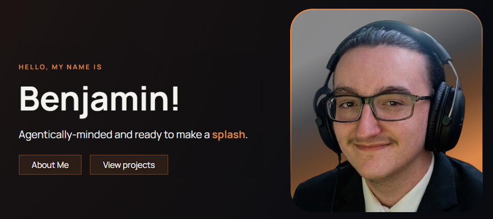

# Benjamin Parsley - Personal Portfolio

This repository contains the source code for my personal portfolio website. You can view the live site at [benparsley.co.uk](https://benparsley.co.uk).

**Note:** This repository is maintained primarily for version control purposes. It is a static, fully responsive website built with a mobile-first approach.

## Included Projects
The portfolio highlights the following projects:
- **Spanish Vocabulary Tool** 
- **Spanish Pronunciation Tool** 
- **AI Music Library**
- **Healthy Tracker**
- **Gemini Folders and Protected Files**
- **What is Cryptography? - Dissertation**

## Tech Stack
- HTML5
- CSS3
- Bootstrap 5.3.3
- JavaScript ES6+

## Recent Updates
- Enhanced mobile UI with dynamic collapsible cards for Projects, Experience, and Certificates.
- Refined responsive grid layouts and component visibility for smaller screens.

## License
This repository is marked as **All Rights Reserved**. The source code is provided for archival, portfolio demonstration, and viewing purposes only. Please do not copy, distribute, modify, or use the source code or assets for any purpose without explicit written permission.
